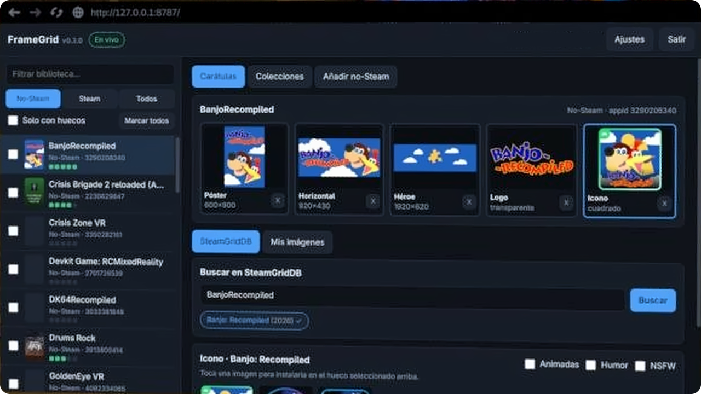
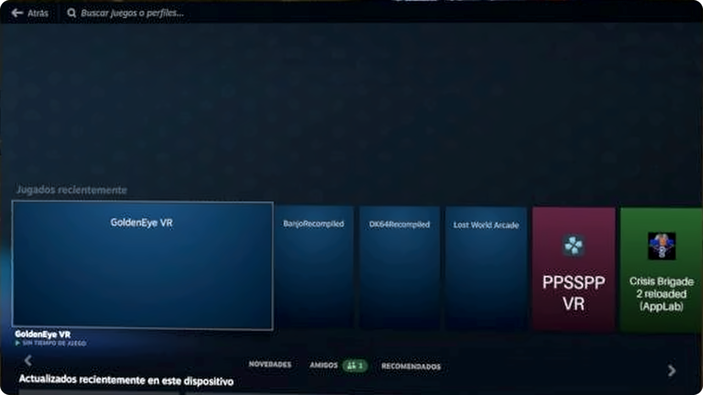
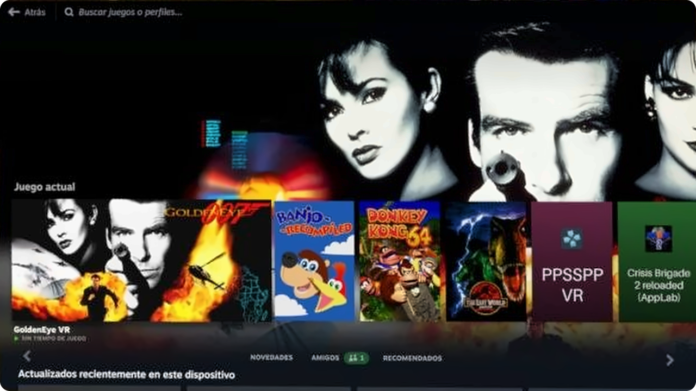
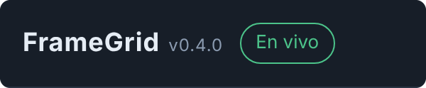
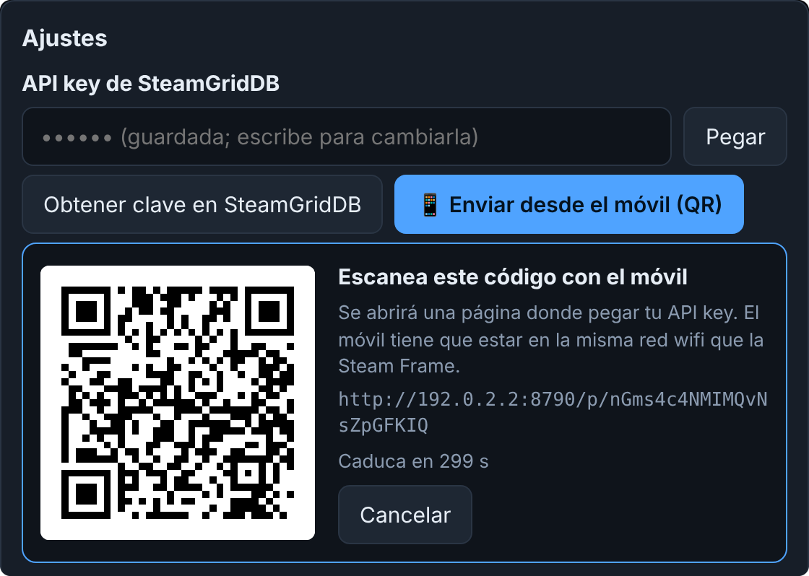
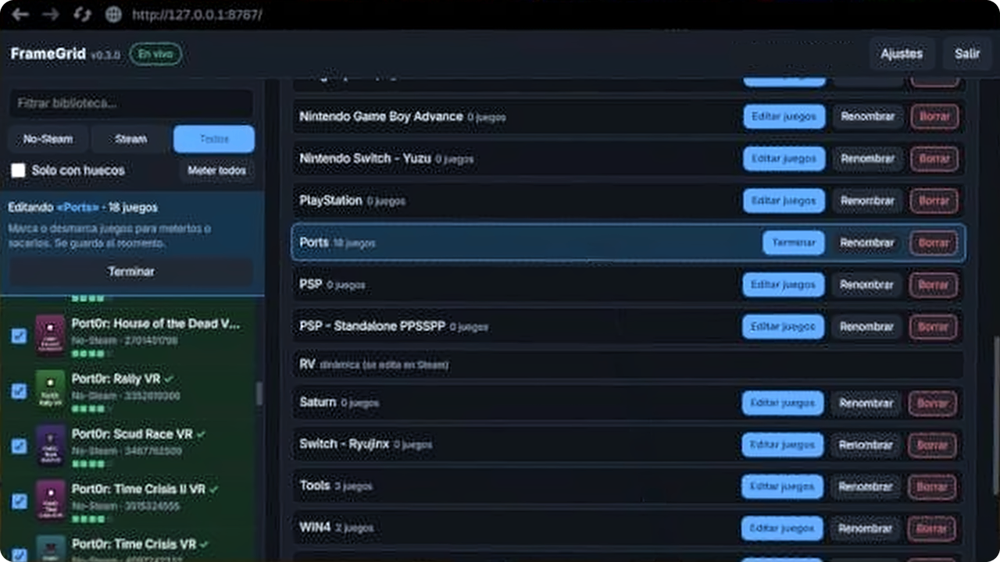
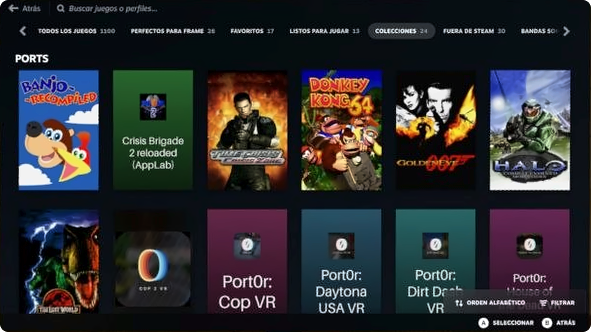

# FrameGrid

[English](README.md) · **Español**

Carátulas personalizadas de [SteamGridDB](https://www.steamgriddb.com) y gestor de colecciones de la biblioteca para **Steam Frame** (SteamOS en ARM). También funciona en Steam Deck, Steam Machine y en cualquier PC Linux con Steam.

En la Steam Frame no hay Decky Loader, no aparece la opción *Administrar › Cambiar imagen personalizada* y las colecciones que creas en otro PC no incluyen tus juegos no-Steam. FrameGrid lo soluciona para las apps que desarrollas, los ports que descargas, los juegos instalados a mano y cualquier otro acceso directo no-Steam.

<p align="center">
  
  <br><em>FrameGrid en la Steam Frame: carátulas de SteamGridDB aplicadas a un juego no-Steam.</em>
</p>

## Antes y después

| Antes | Después |
|:---:|:---:|
|  |  |

<p align="center"><em>La pantalla de inicio de la Steam Frame con accesos directos no-Steam, antes y después de aplicar carátulas con FrameGrid.</em></p>

## Funciones

- **Carátulas**: busca en SteamGridDB y aplica póster (600×900), horizontal (920×430), héroe, logo o icono a juegos de Steam y a accesos directos no-Steam.
- **Tus propias imágenes**: para juegos que no están en SteamGridDB, explora tu carpeta Imágenes o sube un archivo PNG/JPG. Las que tienen la forma adecuada para el hueco elegido aparecen marcadas con *encaja*.
- **Auto-rellenar**: marca varios juegos y rellena todos los huecos vacíos con un clic.
- **Iconos**: para accesos directos no-Steam y, en modo en vivo, también para juegos de Steam.
- **Colecciones**: crea, renombra y borra colecciones, y mete o saca juegos, incluidos los no-Steam, de Favoritos, Ocultos o tus propias colecciones.
- **Añadir apps no-Steam**: añade ports, builds de Godot o cualquier ejecutable a la biblioteca y, si quieres, descarga sus carátulas en el mismo paso.
- **Interfaz en español e inglés**: se cambia con los botones **ES | EN** de la cabecera.
- **API key fácil de introducir**: envíala desde el móvil escaneando un código QR, pégala o abre la página de SteamGridDB con un clic.
- **Sin dependencias**: solo usa Python 3 y su librería estándar. No hace falta pacman, pip ni compilar, y funciona en ARM64 y x86.
- **Interfaz web local** con botones grandes, cómoda con mando. Se abre en el navegador del escritorio o en el navegador interno de Steam.

## Requisitos

- SteamOS (Steam Frame, Steam Deck, Steam Machine) o cualquier Linux con Steam
- Python 3.9 o superior. Ya viene incluido en SteamOS.
- Una API key gratuita de SteamGridDB: inicia sesión en steamgriddb.com y ve a **Preferencias → API**

## Instalación

Cambia el dispositivo al **modo escritorio** y abre una terminal (Konsole).

```bash
# Opción A: descarga el zip de la última versión desde la página de Releases
unzip FrameGrid-*.zip
cd FrameGrid

# Opción B: clona el repositorio
git clone https://github.com/Javigracia/FrameGrid.git
cd FrameGrid

bash install.sh
```

`install.sh` copia FrameGrid en `~/.local/share/framegrid` y lo añade al menú de aplicaciones y al escritorio. Para desinstalarlo: `bash install.sh --uninstall`.

También puedes ejecutarlo sin instalar: `python3 framegrid.py`

## Modo en vivo (imprescindible en Steam Frame)

En la Steam Frame no se puede cerrar Steam. Por eso FrameGrid habla con el Steam **que está abierto** a través de su depurador interno (CEF) en `localhost:8080`, igual que hacen los plugins de Decky. En modo en vivo cada cambio lo aplica el propio Steam y se ve al momento, sin reiniciar.

### Activarlo (solo una vez)

1. Abre FrameGrid y pulsa **«Activar modo en vivo»**. Desde una terminal también puedes ejecutar `python3 framegrid.py --enable-cef`. Las dos opciones crean el archivo `~/.steam/steam/.cef-enable-remote-debugging`.
2. **Reinicia la Steam Frame.** El depurador solo se activa cuando arranca Steam.
3. Vuelve a abrir FrameGrid. El indicador de arriba a la izquierda debe poner **«En vivo»**, en verde.

   


Si después de reiniciar no cambia, actívalo desde los ajustes de Steam: **Sistema → Activar modo desarrollador** y luego **Desarrollador → Depuración remota CEF**. Después vuelve a reiniciar.

Para comprobar el estado desde una terminal:

```bash
python3 ~/.local/share/framegrid/framegrid.py --status
```

### Opcional: añadir FrameGrid a la biblioteca de Steam

Con el modo en vivo activo:

```bash
bash install.sh --steam
```

FrameGrid aparece entonces en tu biblioteca, y al lanzarlo desde ahí se abre en el navegador interno de Steam.

### Modos de trabajo

FrameGrid elige el modo solo y lo muestra en el indicador de arriba a la izquierda.

| Indicador | Cuándo | Qué se puede hacer |
|---|---|---|
| **En vivo** | Steam abierto con el depurador CEF activo | Todo, y se aplica al instante |
| **Steam cerrado · archivos** | Steam no está en marcha, por ejemplo en un PC de escritorio | Todo, editando directamente `shortcuts.vdf`, la carpeta `grid` y `cloudstorage` |
| **Sin modo en vivo** | Steam abierto sin el depurador | Solo carátulas. Se guardan en la carpeta `grid` y se ven **después de reiniciar** el dispositivo. Colecciones y accesos directos quedan bloqueados hasta activar el modo en vivo. |

## Uso

1. **Idioma**: FrameGrid arranca en el idioma del sistema. Puedes cambiarlo cuando quieras con los botones **ES | EN** de la cabecera, y recuerda tu elección.
2. **API key**: la primera vez se abre la ventana de **Ajustes**. Escribir una clave de 32 caracteres en VR es un suplicio, así que hay tres formas de introducirla:
   - **📱 Enviar desde el móvil (QR)** (la más cómoda en VR): escanea el código QR con el móvil, pega tu clave en la página que se abre y pulsa *Enviar a FrameGrid*. La clave aparece en las gafas y Ajustes se cierran solos. El móvil tiene que estar en la misma red wifi que la Steam Frame.
   - **Pegar**: si copiaste la clave en el navegador de la Frame, pulsa *Pegar*.
   - **Obtener clave en SteamGridDB**: abre la página de la API de SteamGridDB para copiarla.

   

   FrameGrid comprueba la clave con SteamGridDB antes de guardarla, así que si está mal copiada te avisa al momento. Se guarda en `~/.config/framegrid/config.json` con permisos 600.
3. **Carátulas**
   1. Elige un juego en la lista de la izquierda. Las pestañas *No-Steam*, *Steam* y *Todos* filtran la lista.
   2. Elige el hueco: *Póster*, *Horizontal*, *Héroe*, *Logo* o *Icono*.
   3. Toca una imagen para aplicarla. Los filtros *Animadas*, *Humor* y *NSFW* cambian los resultados que se muestran.
   4. **¿No está en SteamGridDB?** Cambia a la pestaña *Mis imágenes*. Se abre tu carpeta Imágenes; entra en las subcarpetas y toca una imagen para aplicarla, o pulsa *Subir archivo…* para elegir cualquier PNG/JPG. *Solo las que encajan* oculta las imágenes con una forma que no corresponde al hueco, y *Fijar carpeta* hace que la carpeta actual se abra por defecto.
4. **Auto-rellenar**: marca varios juegos y pulsa **«Auto-rellenar desde SteamGridDB»**. Marca *Sobrescribir existentes* si quieres sustituir también las imágenes que ya tienes.
5. **Colecciones** (pestaña *Colecciones*):
   1. Para crear una, escribe un nombre y pulsa **Crear**. Se abre directamente en modo edición.
   2. Para cambiar una que ya existe, pulsa **Editar juegos** a su lado.
   3. Mientras editas, aparece un aviso azul encima de la lista de juegos y cada casilla significa «este juego está en la colección». Marca o desmarca juegos; cada cambio se guarda al momento. *Meter todos* añade a la colección todos los juegos que se ven en la lista, así que puedes filtrar primero.
   4. Pulsa **Terminar** cuando acabes.

   

   <em>Editando la colección *Ports*: los juegos marcados a la izquierda están dentro.</em>

   

   <em>La colección *Ports* resultante en la biblioteca de la Steam Frame, con sus carátulas.</em>

6. **Añadir no-Steam** (pestaña *Añadir no-Steam*): escribe el nombre y la ruta del ejecutable. La carpeta de inicio y las opciones de lanzamiento son opcionales.
7. Pulsa **Salir** cuando termines.

> Los IDs de los accesos directos no-Steam son propios de cada máquina. Por eso las colecciones con apps no-Steam no se pueden preparar desde otro PC y hay que editarlas en el propio dispositivo. Eso es exactamente lo que hace FrameGrid.

## Opciones de línea de comandos

```
python3 framegrid.py [--port 8787] [--open auto|xdg|steam|none] [--steam-root RUTA]
python3 framegrid.py --status          # modo actual y diagnóstico
python3 framegrid.py --enable-cef      # activa el depurador de Steam (luego reinicia)
python3 framegrid.py --add-to-steam    # añade FrameGrid a la biblioteca de Steam
```

## Copias de seguridad

En **modo en vivo**, Steam aplica cada cambio con sus propias funciones, igual que si lo hicieras desde su interfaz.

En **modo archivos** y en **sin modo en vivo**, FrameGrid hace antes una copia de seguridad:

- Imágenes sustituidas o quitadas: `userdata/<id>/config/grid/.framegrid-backup/`
- `shortcuts.vdf`: `config/shortcuts.vdf.framegrid-FECHA.bak` (se guardan las últimas 10)
- Colecciones: `config/cloudstorage-framegrid-backups/original/`, con el estado de antes del primer cambio, y además las últimas 20 versiones

## Seguridad

El depurador CEF permite que cualquier programa que se ejecute **en el propio dispositivo** controle el cliente de Steam. Es lo mismo que activa Decky Loader en la Steam Deck. El servidor de FrameGrid solo escucha en `127.0.0.1` y rechaza peticiones que vengan de otras webs.

El **envío desde el móvil** abre un segundo servidor temporal en tu red local, solo mientras el código QR está en pantalla. Su dirección lleva un código secreto de un solo uso, y se cierra en cuanto recibe una clave válida, a los 5 minutos o tras 10 intentos fallidos. La clave viaja por tu wifi sin cifrar, así que úsalo solo en una red de confianza; si no, usa *Pegar*.

Para desactivar el depurador, borra `~/.steam/steam/.cef-enable-remote-debugging` y reinicia.

## Solución de problemas

| Problema | Solución |
|---|---|
| El indicador sigue en *Sin modo en vivo* después de reiniciar | Comprueba que existe el archivo `~/.steam/steam/.cef-enable-remote-debugging` o activa *Depuración remota CEF* en los ajustes de Desarrollador de Steam. Ejecuta `--status`. |
| «API key de SteamGridDB no válida (401)» | Genera una key nueva en steamgriddb.com y vuelve a enviarla desde **Ajustes** |
| El móvil no abre la página del QR | Comprueba que el móvil y la Frame están en la misma red wifi (no en una red de invitados) y que el código no ha caducado. Si sigue sin ir, usa *Pegar*. |
| Las carátulas no se ven (sin modo en vivo) | Reinicia el dispositivo. Sin modo en vivo, Steam solo lee la carpeta `grid` al arrancar. |
| No detecta Steam | Usa `--steam-root ~/.local/share/Steam` o indica la carpeta de Steam en **Ajustes** |
| No se abre el navegador | Abre `http://127.0.0.1:8787` a mano o usa `--open steam` |

## Cómo funciona

- **Modo en vivo**: un cliente mínimo del Chrome DevTools Protocol, escrito con la librería estándar, ejecuta JavaScript en el `SharedJSContext` de Steam. Usa las mismas funciones que los plugins de Decky: `SteamClient.Apps.SetCustomArtworkForApp`, `SetShortcutIcon` y `AddShortcut`, además de `collectionStore`.
- **Modo archivos**: lectura y escritura del formato VDF binario de `shortcuts.vdf`, imágenes en `config/grid` y colecciones en `config/cloudstorage/cloud-storage-namespace-1.json`.
- Se descartan las imágenes WebP porque Steam no las carga desde la carpeta grid. Las animadas se descargan como APNG.

## Licencia

FrameGrid es software libre publicado bajo la **Licencia Pública General de GNU v3.0 o posterior** (GPLv3). Consulta [LICENSE](LICENSE).

Puedes usarlo, estudiarlo, compartirlo y modificarlo. Si distribuyes FrameGrid o una versión modificada, tienes que publicar todo el código fuente bajo la misma licencia GPLv3. Nadie puede convertirlo en un producto cerrado.

FrameGrid es y seguirá siendo gratuito. Si alguien te pide dinero por él, puedes conseguirlo gratis aquí.

## Créditos

- Imágenes de [SteamGridDB](https://www.steamgriddb.com). Apoya la web y a sus artistas.
- Códigos QR generados con [QR Code generator library](https://www.nayuki.io/page/qr-code-generator-library) de Project Nayuki (licencia MIT, incluida en `fg/qrcodegen.py`).
- Inspirado en [decky-steamgriddb](https://github.com/SteamGridDB/decky-steamgriddb) y SGDBoop.

FrameGrid no está afiliado a Valve ni a SteamGridDB. Steam y Steam Frame son marcas de Valve Corporation.
